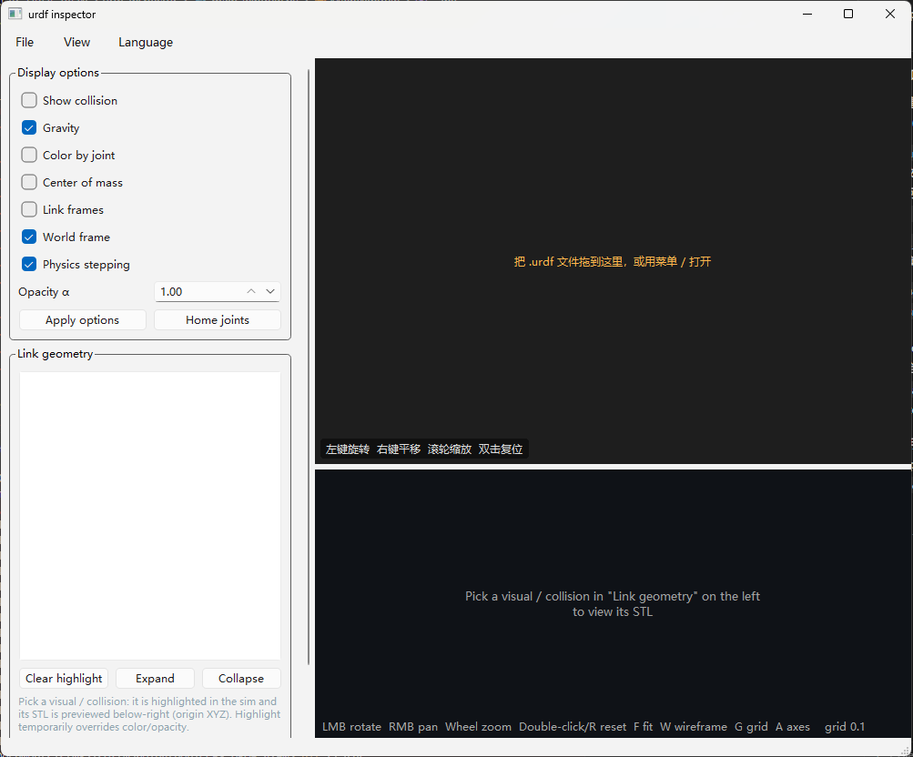
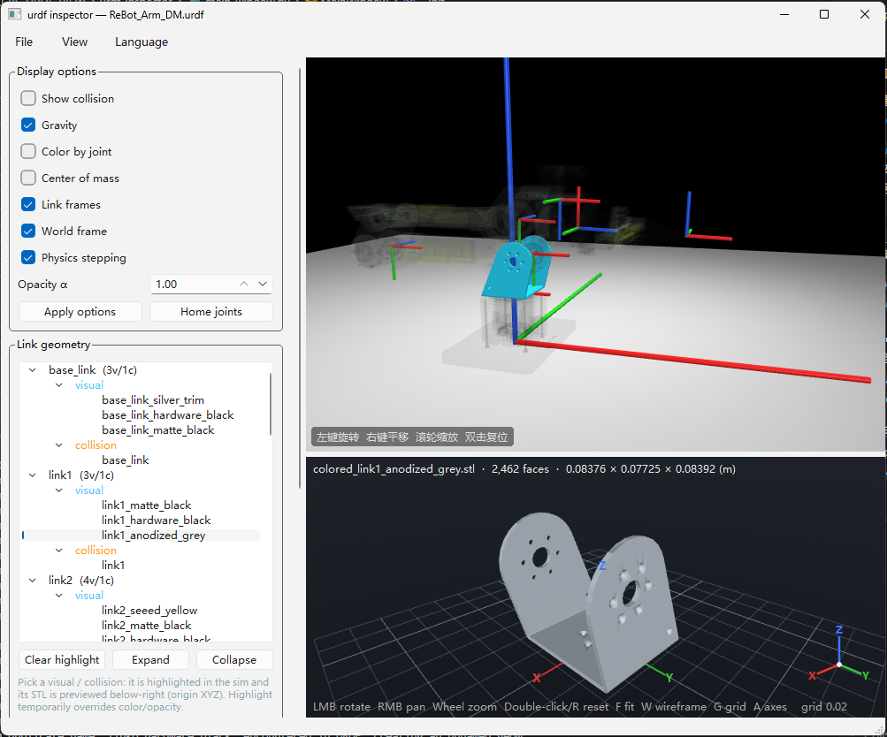

# urdf inspector

**English** | [中文](README.zh.md)

Drag a URDF into a self-drawn Qt window to inspect it (MuJoCo off-screen rendering, no native
`mujoco.viewer`). Pick a link's visual/collision to highlight it in the sim and preview its STL,
drag joint sliders, and toggle coordinate frames / grid. The menu bar switches between English and
Chinese at runtime. MuJoCo MJCF files (`.xml`) can be dropped too and open in view-only mode (see below).

| Empty window (drop target) | URDF loaded |
|---|---|
|  |  |

### Demo

https://private-user-images.githubusercontent.com/34444109/694283238-976c9b32-3dbb-42fb-b1d3-9996dcee1c40.mp4

Dependencies: mujoco (4.x), numpy, PySide6, loguru. Python 3.12.
Open-source repo: [ccbs-tools/urdf-inspector](https://github.com/ccbs-tools/urdf-inspector).

## Download

Grab the latest `urdf-inspector-vX.Y.Z-windows-x64.zip` from
[Releases](https://github.com/ccbs-tools/urdf-inspector/releases), unzip anywhere and run
`urdf-inspector.exe`. No installation required; `SHA256SUMS.txt` next to it lets you verify the download.

Requirements: Windows 10/11 x64.

## Install

Needs [uv](https://docs.astral.sh/uv/) (it will fetch Python 3.12 itself, see `.python-version`):

```powershell
git clone https://github.com/ccbs-tools/urdf-inspector.git
cd urdf-inspector
uv sync
```

## Run

```powershell
uv run urdf-inspector
# or
uv run python -m urdf_inspector path/to/robot.urdf
# same for MJCF
uv run python -m urdf_inspector path/to/scene.xml
```

## Layout

- **Left** (vertical scroll): display options → link geometry tree (click to highlight and preview the matching STL) → joint sliders
- **Top-right**: MuJoCo simulation viewport (drop a `.urdf` / MJCF `.xml`, or File → Open)
- **Bottom-right**: STL preview (origin XYZ axes + ground grid)

## Controls

Both viewports: left drag rotate, right drag pan, wheel zoom, double-click reset.
The STL preview also supports `F` fit, `W` wireframe, `G` grid, `A` axes.
A `.urdf` / `.xml` can be dropped anywhere on the window; `Ctrl+O` opens the file dialog.

### MJCF (view-only)

The format is decided by the XML root element: `<robot>` is URDF, `<mujoco>` is MJCF (the file
extension does not matter). MJCF files open in view-only mode:

- The model is loaded as-is: collision settings, actuators and damping are untouched. There are no joint sliders, and "Gravity", "Physics stepping" and "Home joints" are disabled.
- Camera, geometry-tree highlighting and the STL preview work. "Show collision", "Color by joint", "Center of mass", the frame toggles and opacity work too; they only change what is drawn.
- `<include>`, `<attach>` sub-models, meshes and textures are resolved relative to the file. A `<mujocoinclude>` fragment cannot be opened on its own; open the main file that includes it.
- MJCF has no visual / collision tags, so the tree splits geoms by default visibility: colliding geoms in group ≥ 3 are listed as collision, everything else as visual.
- The STL preview takes the mesh straight from the compiled model; primitive shapes (box, cylinder, …) have no preview.
- If the model has no ground plane or no light, a display-only plane / directional light is added.

## Package (onedir)

```powershell
uv sync --group dev
uv run pyinstaller main.spec --noconfirm
# Output: dist/urdf-inspector/urdf-inspector.exe, with dependencies in urdf-inspector-lib/
```

## Structure

```
urdf_inspector/
  __main__.py        entry point main()
  main_window.py     main window: options / geometry tree / joints / help menu
  viewport.py        MuJoCo simulation viewport (URDF / MJCF)
  stl_view.py        STL preview (off-screen render)
  model.py           URDF / MJCF → MuJoCo model build, view options
  meshio.py          mesh loading (STL / DAE …)
  i18n.py            language strings and runtime switching
  icons.py           application icon
  log.py             loguru logging (%APPDATA%\ccbs\urdf-inspector\logs\app.log)
  changelog.py       version history & update check
  version_dialogs.py version info / update-check dialogs
assets/              icon.ico / icon.png and README screenshots
run.py               PyInstaller entry
main.spec            PyInstaller config
.github/workflows/build.yml  Windows packaging & Release
```
