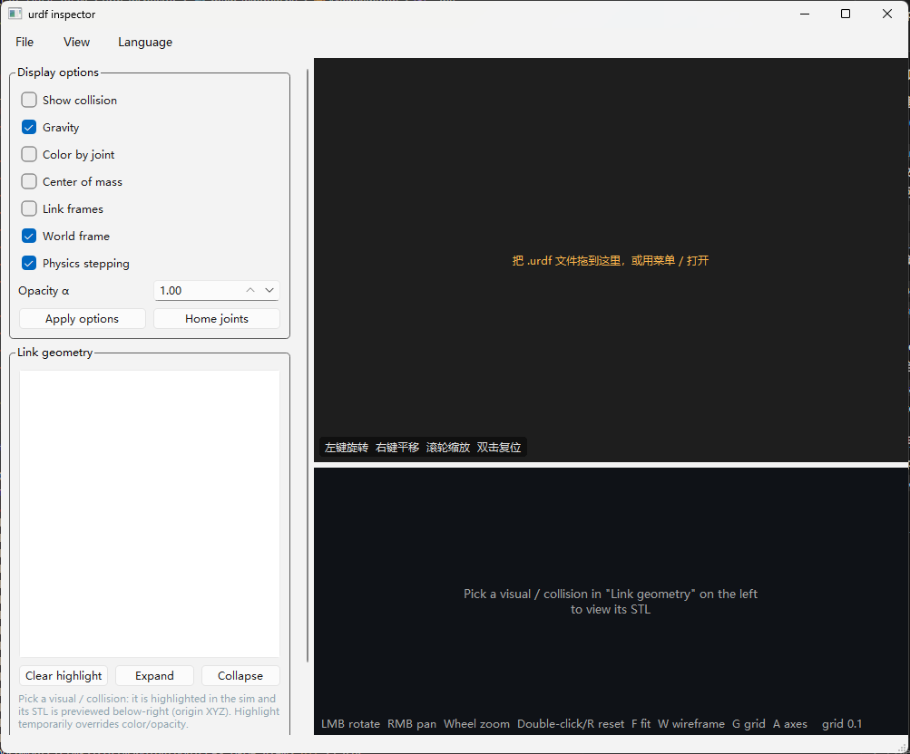
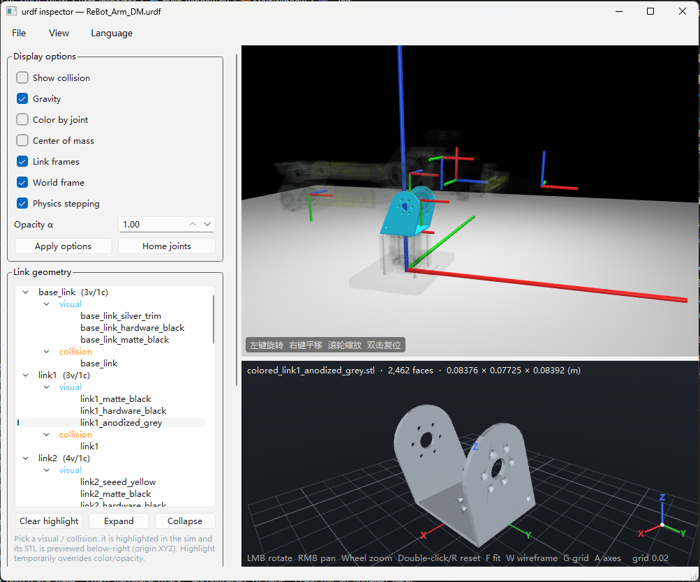

# urdf inspector

[English](README.md) | **中文**

拖放 URDF 到自绘 Qt 窗口查看（MuJoCo 离屏渲染，不用原生 `mujoco.viewer`）。点选某个连杆的
visual/collision 可在仿真中高亮并预览对应 STL，拖动关节滑条，开关坐标系/网格。菜单栏支持中英文实时切换。

| 空窗口（拖放区） | 已加载 URDF |
|---|---|
|  |  |

### 演示

https://private-user-images.githubusercontent.com/34444109/694283238-976c9b32-3dbb-42fb-b1d3-9996dcee1c40.mp4

依赖：mujoco、numpy、PySide6。

## 安装

```bash
cd path/to/urdf-inspector
uv venv && uv pip install -e .
```

## 运行

```bash
urdf-inspector
# 或
python -m urdf_inspector path/to/robot.urdf
```

## 布局

- **左**（竖向滚动）：显示选项 → 连杆几何树（点选高亮并预览对应 STL）→ 关节滑条
- **右上**：MuJoCo URDF 仿真视口（拖入 `.urdf` 或 文件 → 打开）
- **右下**：STL 预览（原点 XYZ 轴 + 地面网格）

## 操作

两个视口均可左键旋转、右键平移、滚轮缩放、双击复位；STL 预览还支持 `F` 适配、`W` 线框、`G` 网格、`A` 坐标轴。

## 打包（onedir）

```bash
uv pip install pyinstaller
uv run pyinstaller urdf_inspector.spec --noconfirm
```

## 结构

```
urdf_inspector/
  __main__.py     入口 main()
  main_window.py  主窗口：显示选项 / 连杆几何树 / 关节控制
  viewport.py     MuJoCo URDF 仿真视口
  stl_view.py     STL 预览（离屏渲染）
  model.py        URDF → MuJoCo 模型构建、显示选项
  meshio.py       网格读取（STL / DAE …）
  i18n.py         多语言字符串与运行时切换
run.py            PyInstaller 入口
urdf_inspector.spec  PyInstaller 配置
```
