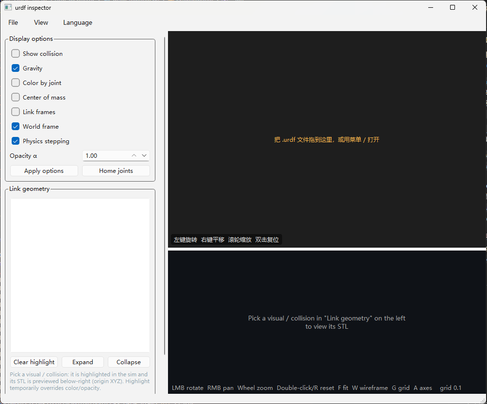
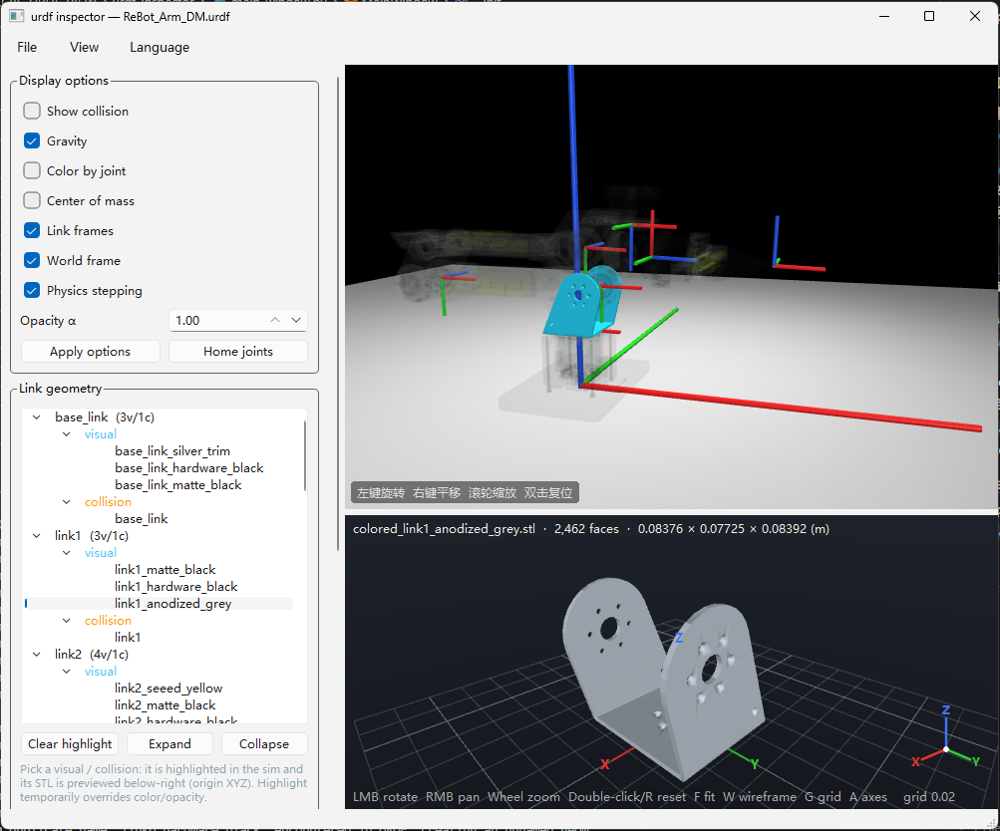

# urdf inspector

[English](README.md) | **中文**

拖放 URDF 到自绘 Qt 窗口查看（MuJoCo 离屏渲染，不用原生 `mujoco.viewer`）。点选某个连杆的
visual/collision 可在仿真中高亮并预览对应 STL，拖动关节滑条，开关坐标系/网格。菜单栏支持中英文实时切换。

| 空窗口（拖放区） | 已加载 URDF |
|---|---|
|  |  |

### 演示

https://private-user-images.githubusercontent.com/34444109/694283238-976c9b32-3dbb-42fb-b1d3-9996dcee1c40.mp4

依赖：mujoco（4.x）、numpy、PySide6、loguru，Python 3.12。开源仓库：[ccbs-tools/urdf-inspector](https://github.com/ccbs-tools/urdf-inspector)。

## 下载

到 [Releases](https://github.com/ccbs-tools/urdf-inspector/releases) 下载最新的
`urdf-inspector-vX.Y.Z-windows-x64.zip`，解压到任意位置运行 `urdf-inspector.exe`。免安装；旁边的 `SHA256SUMS.txt` 可用来校验。

要求：Windows 10/11 x64。

## 安装

需要 [uv](https://docs.astral.sh/uv/)（会自动下载 Python 3.12，见 `.python-version`）：

```powershell
git clone https://github.com/ccbs-tools/urdf-inspector.git
cd urdf-inspector
uv sync
```

## 运行

```powershell
uv run urdf-inspector
# 或
uv run python -m urdf_inspector path/to/robot.urdf
```

## 布局

- **左**（竖向滚动）：显示选项 → 连杆几何树（点选高亮并预览对应 STL）→ 关节滑条
- **右上**：MuJoCo URDF 仿真视口（拖入 `.urdf` 或 文件 → 打开）
- **右下**：STL 预览（原点 XYZ 轴 + 地面网格）

## 操作

两个视口均可左键旋转、右键平移、滚轮缩放、双击复位；STL 预览还支持 `F` 适配、`W` 线框、`G` 网格、`A` 坐标轴。
`.urdf` 可以拖到窗口任意位置；`Ctrl+O` 打开文件对话框。

## 打包（onedir）

```powershell
uv sync --group dev
uv run pyinstaller main.spec --noconfirm
# 输出 dist/urdf-inspector/urdf-inspector.exe，依赖在 urdf-inspector-lib/ 下
```

## 结构

```
urdf_inspector/
  __main__.py        入口 main()
  main_window.py     主窗口：显示选项 / 连杆几何树 / 关节控制 / 帮助菜单
  viewport.py        MuJoCo URDF 仿真视口
  stl_view.py        STL 预览（离屏渲染）
  model.py           URDF → MuJoCo 模型构建、显示选项
  meshio.py          网格读取（STL / DAE …）
  i18n.py            多语言字符串与运行时切换
  icons.py           应用图标
  log.py             loguru 日志（%APPDATA%\ccbs\urdf-inspector\logs\app.log）
  changelog.py       版本历史与检查更新
  version_dialogs.py 版本介绍 / 检查更新对话框
assets/              icon.ico / icon.png 与 README 截图
run.py               PyInstaller 入口
main.spec            PyInstaller 配置
.github/workflows/build.yml  Windows 打包与 Release
```
